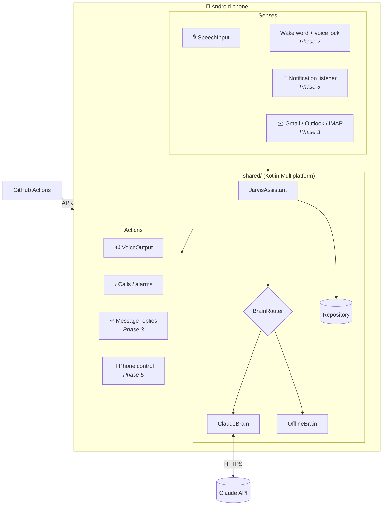

# Jarvis Blueprint: every feature from A to Z

This is the master plan, built from your answers to the 5 question rounds. Each phase ends with a **working APK on your phone** plus a **lesson** in `docs/lessons/`.

## 1. Your decisions

| Area | Decision | Why it matters |
|---|---|---|
| Tech stack | **Kotlin + Jetpack Compose**, structured as **Kotlin Multiplatform** | Native Android access for the deep features; ~70% of the code reusable on iPhone later |
| AI brain | **Claude smart mix** (Haiku 5.5 quick, Opus 5.5 deep) **+ offline brain + switch** | Best quality while you have credit; keeps working at $0 without it |
| Voice lock | **Open-source, offline** (sherpa-onnx + NeMo TitaNet-small), chosen after testing 3 models on real voices | Free forever, private, no account |
| Wake word | **"Hey Jarvis" and "Jarvis"** both work | Convenience; voice lock blocks other people |
| Calls | **In-app full-screen call screen** | Free, rings on the lock screen, no phone number needed |
| Email | **Gmail, Outlook/Hotmail, University** | Gmail API + Microsoft Graph + IMAP fallback |
| Announcing | **Smart filter**: urgent and VIP read aloud live, the rest batched | No noise from group chats |
| Replies | **Read back and confirm** before sending | A misheard word never reaches your professor |
| Day logging | Voice log + morning plan → night check + study timer + auto-tracking | Debrief knows your real day |
| Study features | Doubt-clearing tutor, quiz, spaced-repetition cards, tomorrow's plan + stats | The evidence-based learning stack |
| Extra sources | SMS + missed calls, Google Calendar, Google Classroom, Telegram + Discord | One assistant for everything |
| Extra powers | Morning briefing, voice phone control, focus mode, developer mode | Built for an SE student |
| Look | **Iron Man HUD** (arc reactor) + command center | |
| Personality | **Adaptive**: butler by default, coach when slacking, friend when stressed | |
| Language | Understands **Pashto + Urdu + English mixed**, replies in English | |
| Phone | **Samsung** (One UI battery settings handled) | |
| Build style | **Phases + a lesson for each** | Learn while you build |

## 2. Architecture

**Golden rules** (they recur in every phase):
1. **Interfaces at every boundary.** `Brain`, `TextStorage`, `CallScheduler`, `LocalLlm`: anything can be swapped or faked in tests.
2. **The brain decides, the app acts.** Claude returns `speech + actions` as strict JSON; the app runs the actions. The model never touches your phone directly.
3. **Offline first, cloud when it helps.** Every feature has an offline path, even if it's simpler.
4. **Your data stays on your phone.** Only the text of a request goes to Claude.

## 3. Roadmap

### ✅ Phase 1: Jarvis wakes up (this build)
- [x] Kotlin Multiplatform project (Gradle 9.6, AGP 9.4, Kotlin 2.4), CI/CD to a downloadable APK
- [x] Iron Man HUD: animated arc reactor, voice wave, transcript, command center
- [x] Talk by tapping the core or typing; speech recognition with mixed-language support
- [x] Jarvis calls you: exact alarms → full-screen call screen → two-way conversation
- [x] Morning plan call + night debrief call (times configurable, default 08:00 / 23:55)
- [x] Plan, study and problem logging by voice; tap to tick tasks
- [x] Claude smart mix + offline rules brain + on-device LLM + automatic fallback
- [x] Encrypted API key, Samsung reliability checklist, 34 unit tests

### ✅ Phase 2: Always listening, only to you
- [x] Foreground "Jarvis is listening" service (Android requires the permanent notification)
- [x] Wake words "Hey Jarvis" and "Jarvis" with sherpa-onnx keyword spotting (offline): 92% detection, 0/100 false alarms in testing
- [x] Voice lock: 8-sample enrollment, speaker verification on every wake (NeMo TitaNet-small), 3 strictness levels
- [x] Sessions record `verifiedSpeaker`, so Phase 3 can demand fingerprint or a confirm phrase before sending messages
- [x] Battery tuning: an adaptive energy gate skips the wake-word model in quiet rooms
- [x] Supply-chain security: every downloaded model and library is SHA-256 pinned
- **Lesson:** [docs/lessons/phase-2.md](lessons/phase-2.md) (foreground services, audio DSP, keyword spotting, embeddings, FAR/FRR evaluation)

### Phase 3: Messages & email
- [ ] `NotificationListenerService`: WhatsApp, Instagram, Snapchat, Telegram, Discord, SMS, missed calls
- [ ] Smart filter: urgency classifier + VIP list → live announce vs digest ("Jarvis, what did I miss?")
- [ ] Reply through the notification's own Reply button (`RemoteInput`) with read-back-and-confirm
- [ ] Gmail API (OAuth), Microsoft Graph (Outlook/Hotmail), IMAP fallback for university mail
- [ ] Email summaries in the debrief; "reply to the professor: …"
- **Known limits:** apps only expose *new* messages via notifications (no history); Snapchat usually hides message text
- **Lesson topics:** OAuth 2.0, REST APIs, notification internals, privacy design

### Phase 4: Study system
- [ ] Study session timer ("start studying OS" … "stop") with per-subject stats
- [ ] Auto-generated flashcards from what you studied; spaced repetition (SM-2 algorithm)
- [ ] Quiz mode during the night call; weak topics resurface
- [ ] Focus mode (Pomodoro, notifications held, VIP-only interrupts)
- [ ] Google Calendar + Google Classroom deadlines in the plan and debrief
- [ ] Weekly report: streaks, hours per subject, plan completion rate
- **Lesson topics:** Room/SQL databases, algorithms (SM-2), data visualisation, Google APIs

### Phase 5: Superpowers & iPhone
- [ ] Morning briefing call: weather, classes, deadlines, overnight messages, top 3 goals
- [ ] Voice phone control: call people, open apps, flashlight, timers, volume, DND
- [ ] Developer mode: GitHub notifications, daily LeetCode, "explain this error" from a screenshot
- [ ] Automatic usage tracking (screen time per app) in the debrief
- [ ] iPhone app with Compose Multiplatform (needs a Mac or cloud Mac, plus an Apple developer account)
- **iPhone reality:** no reading WhatsApp/Instagram/Snapchat and no always-on wake word (Apple only allows Siri). Email, debrief, tutoring, calls via AlarmKit and Siri Shortcuts all work.

## 4. Costs

| Item | Cost |
|---|---|
| Claude API, smart mix, daily use | ~$8–15 / month (set a spend limit in the console) |
| Offline mode | $0 |
| sherpa-onnx (wake word, voice lock), LiteRT-LM, GitHub Actions (public repo) | $0 |
| Apple developer account (only for iPhone) | $99 / year |

## 5. Platform rules we design around
- **Google Play** restricts notification access and Gmail scopes, so Jarvis ships as a sideloaded APK (fine for personal use).
- **Android 14+**: full-screen call screens need the "full-screen notifications" permission (Setup › Reliability checks it).
- **Samsung One UI** kills background apps aggressively: "Unrestricted" battery + "Never sleeping apps" are required for Phase 2's always-on listening.
- **Claude API ≠ Claude.ai subscription**: the API is billed separately.
